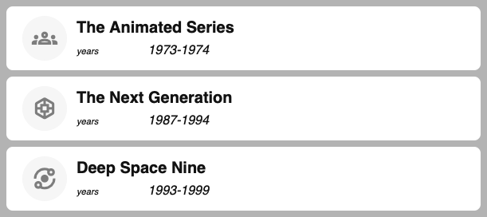
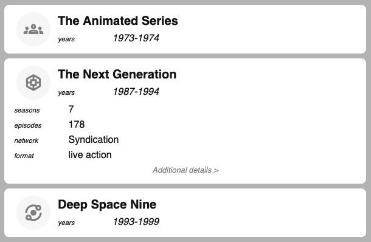
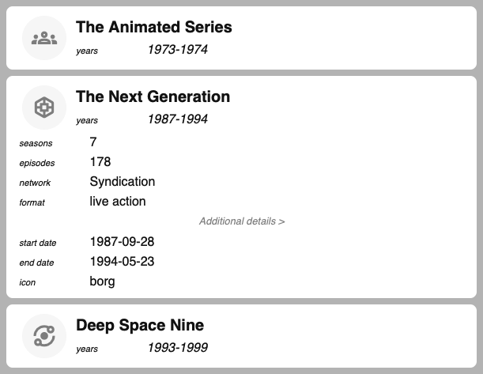

# JCU Digital Library Catalogue - Front End

> TODO is there a better title for the front end doc

> TODO probably need a table of contents

> TODO link to parent doc too

## Overview

The JCU DLC front end takes a data file holding all your *items*, and presents those items in a Catalogue interface that gives users a searchable, filterable list.

The Catalogue interface shows a sidebar of filterable dimensions, and a item list displaying the items that match your currently selected filters and searches.


## Data Prep

> TODO properly link to data prep

Go read the docs for the data prep side.


## Files

Displaying a JCUDLC on a web page requires four files on your web server, in addition to the web page itself.

**`jcudlc.js`** is the main JavaScript file that does the job of creating and managing the Catalogue. You never need to edit this file, it just needs to be loaded onto the page.

**`jcudlc-style.css`** is the CSS file that provides format to the elements within the Catalogue. You never need to edit this file, it just needs to be loaded onto the page.

**`jcudlc-data.json`** is your data, the list of all the items that the Catalogue will be searching and displaying. You prepare this file using the data-prep process documented elsewhere. The name of this data file can be anything you like, just set it in your config file.

**`jcudlc-config.json`** is your configuration. JCUDLC uses sensible defaults so that you will get some kind of reasonable result without having to change much in here, but you will probably want to tweak a few things, and how to do that is documented down below.


## Setup

Add a link to the CSS file inside your page's `<head>` tag. If you use icons, also add a link to the icon font.

```html
<head>
    ...
    <link rel="stylesheet" href="https://fonts.googleapis.com/css2?family=Material+Symbols+Outlined" />
    <link rel="stylesheet" href="./jcudlc-style.css" />
    ...
</head>
```

Add an empty `div` tag somewhere in body of your page with an id of `jcudlc`, wherever you want your Catalogue to show up. When the javascript runs, it will build the Catalogue inside this div.

```html
<body>
    ...
    <div id="jcudlc"></div>
    ...
```

Add a link to the javascript just before your page's closing `body` tag.

```html
    ...
    <div id="jcudlc"></div>
    <script src="./jcudlc.js"></script>
</body>
```
That's all the page setup. You also need to make sure your files are in place, and then you're all set!


## Configuration

You use the configuration file to set up how you want the Catalogue to behave.

> TODO add all the other config stuff

### Configuration summary table

| Config Key               | Default Value                       | Description |
| ------------------------ | ----------------------------------- | ----------- |
| `project`                | *(no default)*                      | descriptive |
| `version`                | *(no default)*                      | JCU DLC's version |
| `copyright`              | *(no default)*                      | JCU DLC's copyright statement |
| `dataUrl`                | `./jcudlc-data.json`                | Where to find the data file containing Catalogue items |
| `titleFields`            | `['header', 'title', 'name']`       | Item fields to include as titles in the Header section |         
| `subtitleFields`         | `['author', 'authors', 'editors']`  | Item fields to include as subtitles in the Header section |
| `hideValues`             | `[]`                                | Don't show item properties with any of these values |


### Locate the data file

JCUDLC will load the item list from a JSON file you have prepared with JCU DLC's back end tools or in some other way. The config key `dataUrl` specifies that file. Starting with dot-slash `./` will make the path relative to the web page the Catalogue is running in. By default JCUDLC looks for a file called `jcudlc-data.json` at the same path as your HTML file.

### Display item properties

Within a single item result, there are three sections in which item properties can appear: a header, a main body, and a "quiet" section. Initially results are displayed with just the header section showing. Clicking or tapping the header opens or closes the main body. If there are fields allocated to the "quiet" section, then a link at the bottom of the main body will open or close the quiet section when clicked or tapped.

In the image below, you can see three items. These are all closed, so just their header sections are showing.


The item header has two parts that JCUDLC refer to as the ***Title*** and the ***Subtitle***. You can place fields into these sections using configuration lists `titleFields` and `subtitleFields`. For the example shown, this is set to:

```json
"titleFields": ["title"],
"subtitleFields": ["years"],
```
That configuration will put the item's `title` field into the Title part, and the item's `years` field into the Subtitle part. If not specified in config, JCUDLC will default to `header`, `title`, and `name` as the title fields, so technically the example didn't need to specify `titleFields` at all.

Defaults for subtitle are `author`, `authors`, and `editors`.

The formatting of each part is also customisable using JCUDLC's [formatting keywords](#formatting-keywords). In the example here, we're using:
```json
"titleFormat": "bigger bold unlabelled",
"subtitleFormat": "italic",
```
The defaults for these are `bold unlabelled` for `titleFormat` and `italic` for `subtitleFormat`.

Once the user taps on the "The Next Generation" header, that item expands to display its fields. The image below shows The Next Generation item expanded. In this view, the fields in the header appear only in the header, and the item's main body contains all the remaining fields.


Sometimes you might have more obscure, less generally useful fields in your items. You can hide these under a link, so that the expanded item doesn't show these extra fields by default, but the user can see them if they need to by clicking a link. JCUDLC calls these ***quiet*** fields. The image below shows our example item after the user taps on "Additional details".


### Hide blank values

By default it will show all item proerties, but JCUDLC can hide item properties that seem blank. To get this behaviour, supply the `hideValues` config key, and provide a list of blank-ish values. For example, your data might use any of blank strings, `N/A`, and `NONE` for unspecified values, so set `hideValues` to `["", "N/A", "NONE"]` to omit any item proerties set to one of those values.


## Formatting keywords

JCUDLC uses keywords for convenient configuration of formatted text. You will supply a list of keywords as a single space-separated string, so if you want your titles to be bold and italic and be a bit smaller than normal text, you can set `titleFormat` to `"bold italic smaller"`.

Not all keywords are valid in all config keys; if a format doesn't make sense then it won't work &ndash; for example, `unlabelled` only applies to the format of item properties.

| Formatting keyword | Effect   |
| ------------------ | -------- |
| `bold`             | render text in a **bold** font  |
| `italic`           | render text in an *italic* font |
| `faded`            | render text in a greyed-out colour |
| `smaller`          | render text smaller than normal |
| `bigger`           | render text bigger than normal |
| `right`            | right-align text |
| `center`           | center-align text  |
| `unlabelled`       | don't show the property label |


## Limitations

> TODO not sure what to put here?