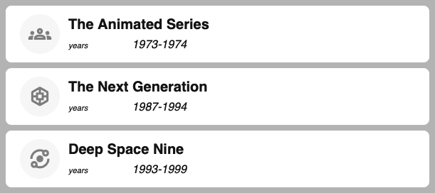
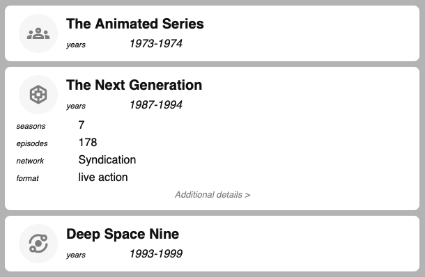
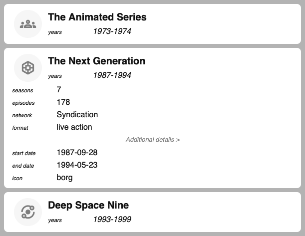

# JCU DLC - Web Interface

## Overview

This document describes the web front end of the JCU Digital Library Catalogue, a zero-dependency tool to display and filter a list of items.

For general info about the tool, visit the [JCU DLC main page](index.html). For information about preparing your data list, refer to the [JCU DLC Data Prep](dataprep.html) docs.


## Quick start

You need five files to get an example JCUDLC working.

The first is a HTML page. Later you can expand this with more content, but for now a minimal HTML page that works is:

```html
<!DOCTYPE html>
<html>
    <head>
        <title>JCU DLC Example</title>
        <!-- grab the Google Material Symbols font for icons -->
        <link href="https://fonts.googleapis.com/css2?family=Material+Symbols+Outlined" rel="stylesheet" />
        <link rel="stylesheet" href="./jcudlc-style.css" />
        <style>
            body { font-family: sans-serif; }
        </style>
    </head>
    <body>
        <h1>JCU Digital Library Catalogue example</h1>
        <div id="jcudlc">
            <!-- catalog goes here -->
        </div>
        <script src="./jcudlc.js"></script>
    </body>
</html>
```

Save this content as `index.html`. 

Visit the github repository page for [`jcudlc.js`](https://github.com/jcu-eresearch/jcudlc/blob/main/web/jcudlc.js), find the download button, and save the file to the same directory as your `index.html`.

Do the same for [`jcudlc-style.css`](https://github.com/jcu-eresearch/jcudlc/blob/main/web/jcudlc-style.css), saving it to the same directory.

Next we'll set up a sample data file. Here's one with a few entries; save this as `jcudlc-data.json` in the same directory as your other files.

```json
[
    {
        "title": "The Animated Series",
        "seasons": "2",
        "years": "1973-1974",
        "format": "animated",
        "icon": "groups"
    },
    {
        "title": "The Next Generation",
        "seasons": "7",
        "years": "1987-1994",
        "format": "live action",
        "icon": "borg"
    },
    {
        "title": "Deep Space Nine",
        "seasons": "7",
        "years": "1993-1999",
        "format": "live action",
        "icon": "orbit"
    }
]
```
And finally, a minimal configuration. Save the content below into a file called `jcudlc-config.json` in the same directory as everything else.

```json
{
  "titleFields": ["title"],
  "subtitleFields": ["years"],
  "noFilter": [ "title", "years" ],
  "quietFields": [ "icon" ]
}
```

That's it! If you serve this directory using [Caddy](https://caddyserver.com/) or a similar tool and load the index.html file into a browser, you should see an example of the JCU DLC showing info about a few Star Trek series.

If you're using Caddy, this command line will start a https server at [https://localhost](https://localhost). You may need to approve some certificate management actions first.

```bash
$ caddy file-server --domain localhost
```

> TODO try this

## Setup

### Files

Displaying a JCU Digital Library Catalogue on a web page requires four files on your web server, in addition to the web page itself.

#### The source code, `jcudlc.js` 

**`jcudlc.js`** is the main JavaScript file that does the job of creating and managing the Catalogue. You never need to edit this file, it just needs to be loaded onto the page.

#### The CSS, `jcudlc-style.css`

**`jcudlc-style.css`** is the CSS file that provides formatting to the elements within the Catalogue. You never need to edit this file, it just needs to be loaded onto the page.

#### Your data, `jcudlc-data.json`

**`jcudlc-data.json`** is your data, the list of all the items that the Catalogue will be searching and displaying. You prepare this file using the data-prep process documented elsewhere. The name of this data file can be anything you like, just set it in your config file.

#### Your configuration, `jcudlc-config.json`

**`jcudlc-config.json`** is your configuration. JCUDLC uses sensible defaults so that you will get some kind of reasonable result without having to change much in here, but you will probably want to tweak a few things, and how to do that is documented down below.


### HTML page setup

Add a link to the CSS file inside your page's `<head>` tag. If you use icons, also add a link to the icon font.

```html
<head>
    ...
    <link rel="stylesheet" href="https://fonts.googleapis.com/css2?family=Material+Symbols+Outlined" />
    <link rel="stylesheet" href="./jcudlc-style.css" />
    ...
</head>
```

Add an empty `div` tag somewhere in the body of your page with an id of `jcudlc`, wherever you want your Catalogue to show up. When the javascript runs, it will build the Catalogue inside this div. Since this is an `id` property, you can only have one Catalogue per webpage.

```html
<body>
    ...
    <div id="jcudlc"></div>
    ...
```

Add a link to the javascript just before your page's closing `body` tag.

```html
    ...
    <div id="jcudlc"></div>
    <script src="./jcudlc.js"></script>
</body>
```
That's all the page setup. You also need to make sure your files are in place, and then you're all set.


## Configuration

You use the configuration file to set up how you want the Catalogue to behave. JCUDLC comes with sensible defaults for all the configuration settings available, but to get the most out of it you will probbaly need to make some changes.


### Summary tables

These tables offer a brief summary of configuration keys. Further discussion of some of these settings is included below the tables.


#### Configuration summary

| Config Key         | Default Value                       | Description |
| ------------------ | ----------------------------------- | ----------- |
| `project`          | *(no default)*                      | descriptive |
| `version`          | *(no default)*                      | JCU DLC's version |
| `copyright`        | *(no default)*                      | JCU DLC's copyright statement |
| `dataUrl`          | `./jcudlc-data.json`                | Where to find the data file containing Catalogue items |
| `titleFields`      | `['header', 'title', 'name']`, otherwise use the item's first field | Item fields to include as titles in the Header section |         
| `titleFormat`      | `'bold unlabelled'`                 | [Formatting keywords](#formatting-keywords) applied to the `titleFields` |
| `subtitleFields`   | `['author', 'authors', 'editors']`  | Item fields to include as subtitles in the Header section |
| `subtitleFormat`   | `'italic'`                          | [Formatting keywords](#formatting-keywords) applied to the `subtitleFields` |
| `quietFields`      | `[]`                                | Fields that should be hidden until revealed |
| `quietLabel`       | `'more >'`                          | The label the user can click to show the `quietFields` |
| `quietLabelFormat` | `'faded italic center'`             | [Formatting keywords](#formatting-keywords) applied to the `quietLabel` |
| `maxResultCount`   | 100                                 | The maximum number of items to display |
| `noFilter`         | `[]`                                | Fields that should NOT appear in the filter sidebar |
| `hideValues`       | `[]`                                | Don't show item properties with any of these values |
| `separator`        | `'⧸'` (U+29F8, Big Solidus)         | Glyphs used to separate values for multi-valued fields |
| `separatorFormat`  | `'faded'`                           | [Formatting keywords](#formatting-keywords) applied to the `separator` |
| `iconField`        | `icon`                              | The field to use as the icon "name" (see [Google Icons](https://fonts.google.com/icons)) |
| `iconUrl`          | `'url'`                             | The field containing a URL to load when the icon is clicked |
| `iconTooltip`      | `iconDescription`                   | The name of the field to use as the icon's tooltip |
| `hideFromSearch`   | `[]`                                | Fields to NOT include when the user is searching for text |
| `supportText`      | `''`                                | Text to show the user when there's an error |
| `aliases`          | Field names with spaces replacing underscores  | Field names to use instead of what's in your data file |


#### Style customisation summary

Most of JCU DLC's colours and styling can be set in the config file, or in a CSS variable. The default colours set up a dark filter sidebar and a light result column using shades of grey; use these style settings when you want to match your brand colourings.

| Config Key                  <br>CSS Variable                | Default    | Description |
| ----------------------------------------------------------- | ---------  | ----------- |
| `font`                      <br>`--jcudlc-font-family`      | `inherit`  | Font family specification |
| `filterText`                <br>`--jcudlc-filter-text`      | `#ddd`     | Text colour for filters |
| `filterColumnBackground`    <br>`--jcudlc-filter-bg`        | `#111`     | Background for the filters column |
| `filterItemBackground`      <br>`--jcudlc-filter-item`      | `#222`     | Background for a single filter field |
| `filterActiveBackground`    <br>`--jcudlc-filter-active`    | `#333`     | Background for a hovered-over filter field |
| `filterHighlightBackground` <br>`--jcudlc-filter-highlight` | `#000`     | Background for a selected filter value |    
| `dataText`                  <br>`--jcudlc-data-text`        | `#111`     | Text colour for the results column |
| `dataColumnBackground`      <br>`--jcudlc-data-bg`          | `#bbb`     | Background for the results column |
| `dataItemBackground`        <br>`--jcudlc-data-item`        | `#fff`     | Background for a single result item |
| `dataActiveBackground`      <br>`--jcudlc-data-active`      | `#eee`     | Background for the icon |
| `dataHighlightBackground`   <br>`--jcudlc-data-highlight`   | `#ffffec`  | Background for a hovered-over item |
| `interfaceText`             <br>`--jcudlc-interface-text`   | `dataText` | Text colour for general interface messages |
| `interfaceBackground`       <br>`--jcudlc-interface-bg`     | `dataActiveBackground` | Background for general interface messages |
| `alertInfoText`             <br>`--jcudlc-message-good-text`| `#037`     | Text colour for advice text |
| `alertInfoBackground`       <br>`--jcudlc-message-good-bg`  | `#ecf6ff`  | Background for advice text |
| `alertErrorText`            <br>`--jcudlc-message-bad-text` | `#700`     | Text colour for alarm/error text |
| `alertErrorBackground`      <br>`--jcudlc-message-bad-bg`   | `#fee`     | Background for alarm/error text |


### Configuration details

#### Locate the data file

JCUDLC loads your item list from a JSON file you have prepared with JCU DLC's back end tools or in some other way. By default JCUDLC looks for a file called `jcudlc-data.json` at the same path as your HTML file; use the config key `dataUrl` to specify some other path to that file.

Starting with dot-slash or no punctuation (e.g. `./data.json` or `data.json`) will make the path relative to the web page the Catalogue is running in. Starting with a slash will make it a fixed path on your web server (e.g. `/data/startrek.json`). For security reasons, you should not provide a path to a folder that might contain user uploads.


#### Display item fields

Within a single item result, there are three sections in which item fields can appear: a header, a main body, and a "quiet" section. Initially results are displayed with just the header section showing. Clicking or tapping the header opens or closes the main body. If there are fields allocated to the "quiet" section, then a link at the bottom of the main body will open or close the quiet section when clicked or tapped.

##### Title and Subtitle

In the image below, you can see three items. These are all closed, so just their header sections are showing.


The item header has two parts that JCUDLC refer to as the ***Title*** and the ***Subtitle***. You can place fields into these sections using configuration lists `titleFields` and `subtitleFields`. For the example shown, this is set to:

```json
"titleFields": ["title"],
"subtitleFields": ["years"],
```
That configuration will put the item's `title` field into the Title part, and the item's `years` field into the Subtitle part. It's okay to list multiple fields in each list, and all the listed fields will be shown.

If not specified in config, JCUDLC will default to `["header", "title", "name"]` as the Title fields, so technically the example didn't need to specify `titleFields` at all.

Default fields for the Subtitle are `["author", "authors", "editors"]`.

The formatting of each part is also customisable using JCUDLC's [formatting keywords](#formatting-keywords). In the example here, we're using:
```json
"titleFormat": "bigger bold unlabelled",
"subtitleFormat": "italic",
```
The default formats for Title fields are `bold unlabelled`, and `italic` for the format of Subtitle fields.


##### Main detail section

Once the user taps on the "The Next Generation" header, that item expands to display its fields. The image below shows The Next Generation item expanded. In this view, the fields in the header appear only in the header, and the item's main body contains almost all the remaining fields.

There's no need to specify which fields should appear in the Main detail section. Any field you haven't sent to some other section, or hidden entirely, will show up here.



##### Quiet section

Sometimes you might have more obscure, less generally useful fields in your items. You can hide these under a link, so that the expanded item doesn't show these extra fields by default, but the user can see them if they need to by clicking. JCUDLC calls these ***quiet*** fields. The image below shows our example item after the user taps on "Additional details".



You pick fields to hide away in the Quiet section with the `quietFields` config key.
```json
  "quietFields": ["start_date", "end_date", "icon"],
```
In our example, we've made these fields quiet because start date and end date aren't as interesting, and the `icon` field isn't really data at all but metadata selecting the icon that this item should use. More on icons later.

The text "additional details >" in our example is configurable using `quietLabel`, and the format using [formatting keywords](#formatting-keywords) in `quietLabelFormat`. The default label is `more >` formatted with `faded italic center`.

```json
  "quietLabel": "Additional details >",
  "quietLabelFormat": "faded italic center smaller",
```


#### Hide blank values

By default JCUDLC will show all of the fields in each item, but JCUDLC can hide item properties that are blank. To get this behaviour, include the `hideValues` key in your configuration, and provide a list of blank-ish values.

For example, your data might use any of blank strings, `N/A`, and `NONE` for unspecified values. If you set `hideValues` to `["", "N/A", "NONE"]`, then any item field that is set to one of those values will not appear in any section of the displayed item.

JCUDLC items can have [multi-valued fields](#displaying-multi-valued-fields); `hideValues` will only hide a field if all of its values are listed.

#### Displaying multi-valued fields

JCUDLC supports item fields with multiple values. All the values will be displayed with a separator between them; the default separator is a Unicode character called Big Solidus, which is a tall forward slash that looks like this: ⧸ which is displayed in a faded-out colour. We recommend using `faded` to make it clear that the separator isn't part of your item field's value.

Not every font includes every Unicode character, so if your page font doesn't display the Big Solidus, then you might prefer the character called Black Circle `" ● "` or using a common set of characters such as a standard slash `" / "` or a pair of colons `" :: "`. Include spaces before and after if that gives you the look you want.

The separator and its formatting can be set in config using these keys:

```json
  "separator": " ● ",
  "separatorFormat": "faded",
```

#### Icons

You can specify an icon for each item. Icons are specified using the name of a symbol in Google's [Material Design Icon Font](https://fonts.google.com/icons). By default JCUDLC looks for an item field called `icon` but you can change the field name in config.

To find the icon name, visit the [icon font page](https://fonts.google.com/icons and search for the icon you want. Click the icon you like, which will open a sidebar to the right. Scroll to the bottom of that sidebar looking for an "Icon name" section. Copy the name you see there, e.g. "cloud_download". Use that string in your item's `icon` field.

Icons can be links to URLs, if you supply an item field called `url`, or override the fieldname in config and supply a URL in that alternative field. An icon that's a link will get a slightly different rendering than an icon that is not linked.

Hovering over the icon can display pop-up text that by default will come from an item's `iconDescription` field, if the item has one.

```json
"icon": "google_icon_name", 
"iconTooltip": "access_rights",
"iconUrl": "access_link"
```

An item with no icon specified will not have an icon. If you prefer to have a default or "blank" icon, you'll need to manipulate your data to provide that default icon in each item.

The setup instructions for JCUDLC include adding the Google icon font to the page; if you don't use icons on your items, you can leave the icon font part out of your page setup. 

#### Search for a string of characters

JCUDLC lets users search for a word or phrase in an item. By default 

> TODO: complete this section

## Formatting keywords

JCUDLC uses keywords for convenient configuration of formatted text. You will supply a list of keywords as a single space-separated string, so if you want your titles to be bold and italic and be a bit smaller than normal text, you can set `titleFormat` to `"bold italic smaller"`.

Not all keywords are valid in all config keys; if a format doesn't make sense then it won't work &ndash; for example, `unlabelled` only applies to the format of item properties. It's not an error to include formats that don't apply, they simply won't work.

| Formatting keyword | Effect   |
| ------------------ | -------- |
| `bold`             | render text in a **bold** font  |
| `italic`           | render text in an *italic* font |
| `faded`            | render text in a greyed-out colour |
| `smaller`          | render text smaller than normal |
| `bigger`           | render text bigger than normal |
| `right`            | right-align text |
| `center`           | center-align text  |
| `unlabelled`       | don't show the property label |

